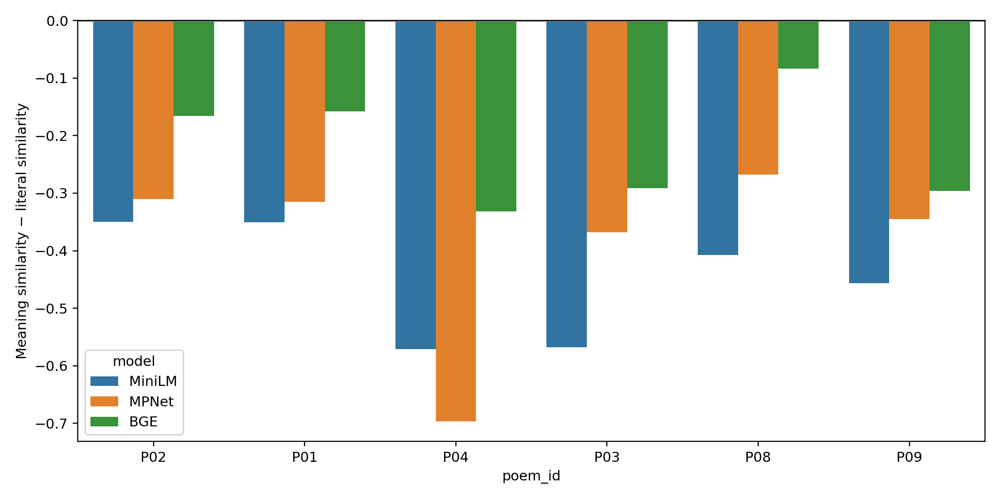
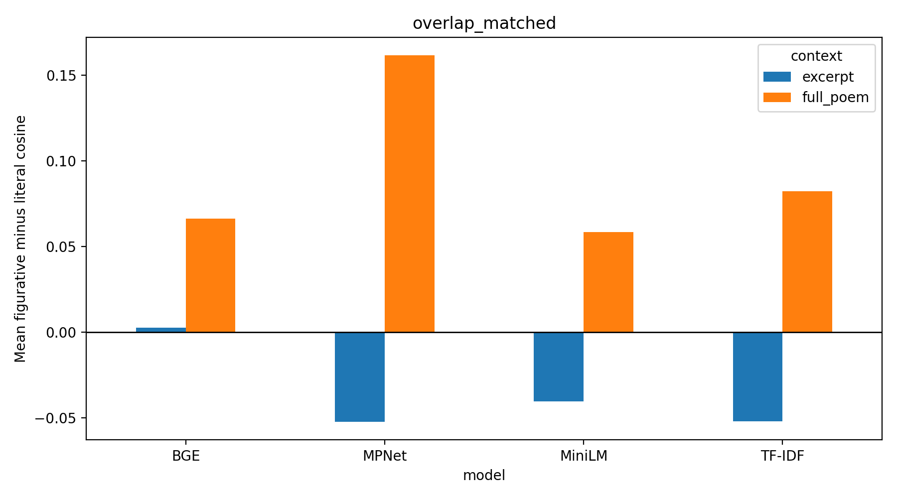
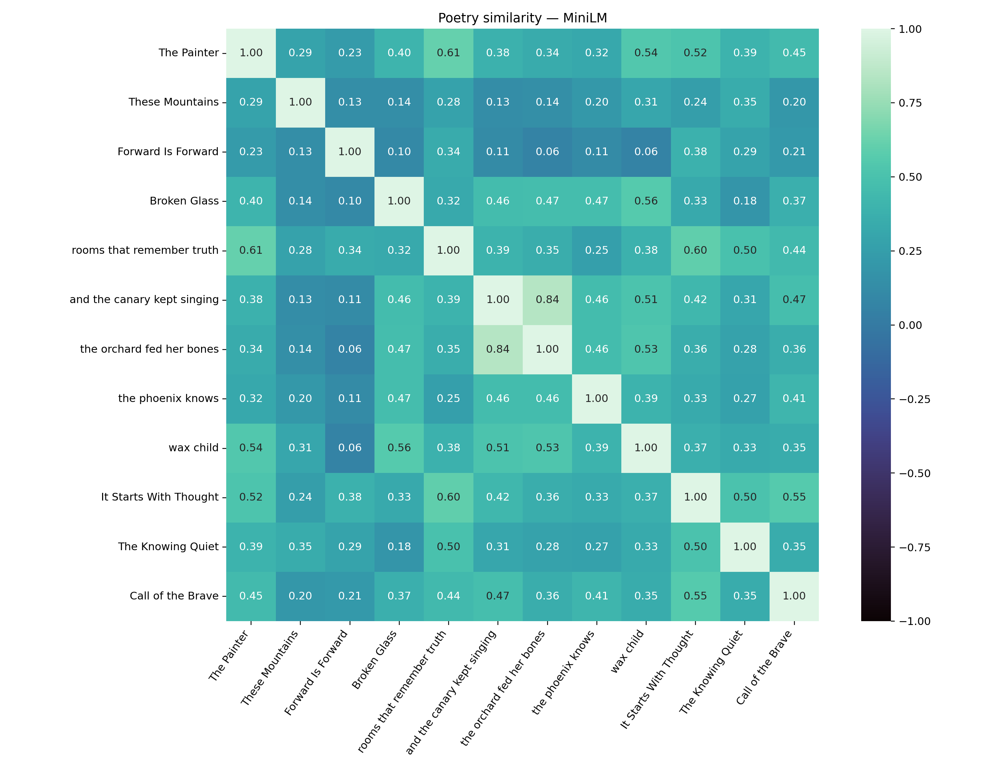

# Poetry in Vector Space

An exploratory investigation of metaphor, context sensitivity and lexical overlap in text embeddings, using 12 of my original poems.

As a developer who also writes poetry, I wanted to investigate what happens when figurative writing is represented as numerical vectors. Rather than treating similarity as understanding, this project examines how retrieval rankings change with context and candidate wording.

## Methods

- MiniLM (384 dimensions), MPNet (768), BGE (768), and a TF-IDF lexical baseline.
- Token-budgeted chunking and normalized, token-weighted pooling for long poems.
- Cosine similarity, pair rankings, PCA visualization and descriptive Spearman agreement.
- Six metaphor probes, followed by 288 similarity scores across two context conditions, six candidates and four methods.

## Results

In the first experiment, the original literal alternative ranked above the figurative alternative in all 18 embedding-model comparisons. In the follow-up, providing more context and changing the candidate wording substantially altered the rankings.

| Candidate condition | Excerpt | Full poem |
|---|---:|---:|
| Original | 0/18 | 6/18 |
| Alternative low-overlap | 8/18 | 14/18 |
| Approximately overlap-matched | 10/18 | 16/18 |

Counts indicate figurative wins across the three embedding models. In the final condition, MPNet and BGE each achieved 6/6, MiniLM 4/6, and TF-IDF 4/6. The lexical baseline also improved with context, so these changes cannot be attributed solely to figurative understanding.

## Repository layout

- `notebooks/`: original experiment and follow-up, with outputs cleared.
- `data/`: annotated poems and challenge candidates.
- `results/`: original run tables, embeddings and metadata, separated by experiment.
- `figures/`: original generated plots.

## Reproduce

Open either notebook in Google Colab (File > Upload notebook) and choose Runtime > Run all. Both notebooks embed their input corpus and install dependencies. Internet access is required for pretrained weights; CPU is supported. Each notebook exports a results ZIP. Run metadata is included under `results/`; model revisions were not pinned, so exact numerical replication is not guaranteed. `requirements.txt` records available package versions from the original run; unrecorded packages are unpinned.

## Limitations

This is a small exploratory case study, not a representative benchmark. Annotations and paraphrases were AI-assisted and not independently validated. Lexical overlap is only approximately controlled. Full-poem inputs change more than context alone; pooling may lose structure. PCA projections distort distances. Similarity scores do not establish comprehension. The notebooks were created with AI assistance; results were generated by running them in Colab.

## Rights

Code is proposed for release under MIT; the original poems remain all rights reserved (see `DATA_LICENSE.md`). This complete archive contains unpublished poetry in notebooks and data. Review before making the repository public.
